```
  ▐█▀▀▀▀▀▀▀▀▀▀▀▀▀▀▀█▌
  ██████╗ ███╗   ██╗██████╗
  ██╔══██╗████╗  ██║╚════██╗
  ██║  ██║██╔██╗ ██║ █████╔╝
  ██║  ██║██║╚██╗██║██╔═══╝
  ██████╔╝██║ ╚████║███████╗
  ╚═════╝ ╚═╝  ╚═══╝╚══════╝
  ▘ ▝   m k 2   ·   m o d
```

# DN2 mk2 mod

**New machines for the Elektron Digitone II, built from your own copy of Elektron's OS.**

The Digitone II ships with five machines. This mod adds four families more, running on
the instrument's own DSP and sitting in MACHINE SEL beside the stock ones, and a set of
sequencer and performance features:

- **The Digitakt II's sample machines**: ONESHOT, WERP, STRETCH, REPITCH, GRID and SLICE,
  with the DT2's own sample engine, its pages, sample list and browser, a recorder, and
  your WAVs sent over USB and kept on the +Drive.
- **FLEX**: an Octatrack-style live buffer machine, recording a track, the input or the
  main mix on recorder trigs and playing it back.
- **PERC, the Machinedrum**: the MD's TRX, EFM, GND and P-I machines (34 of them) from the
  Machinedrum's own firmware, with its track effects.
- **The Monomachine, polyphonic**: SID 6581, DPRO WAVE, DPRO DDRW, DPRO DENS, VO-6 and the
  FM+ machines STAT, PAR and DYN, from the Monomachine's own firmware, drawn as the
  Monomachine draws them, and playing chords.
- **Sequencer and performance**: PERFORM macros (after the Analog Four MKII), Direct Jump,
  parameter slides, keyboard HOLD, microtuning, the arpeggiator on MIDI tracks, arp offsets
  in key and in-key transpose.

Everything else on the instrument works as stock: the stock machines, the sequencer,
projects, presets and kits.

> **Not made or supported by Elektron.** This is unofficial firmware. You flash it at your
> own risk. Back up your +Drive first, every time.

**Contents:** [What's in it](#whats-in-it) ([sample machines](#the-digitakt-iis-sample-machines) · [FLEX](#flex-the-live-buffer) · [PERC](#perc-the-machinedrum) · [Monomachine](#the-monomachine) · [sequencer and performance](#sequencer-and-performance)) · [Install](#install) ·
[Going back, and recovery](#going-back-and-recovery) · [Compatibility](#compatibility) ·
[Known limitations](#known-limitations) · [How it's made and tested](#how-its-made-and-tested) ·
[Versions](#versions) · [Credits](#credits) · [Licence](#licence)

---
<p align="center">
  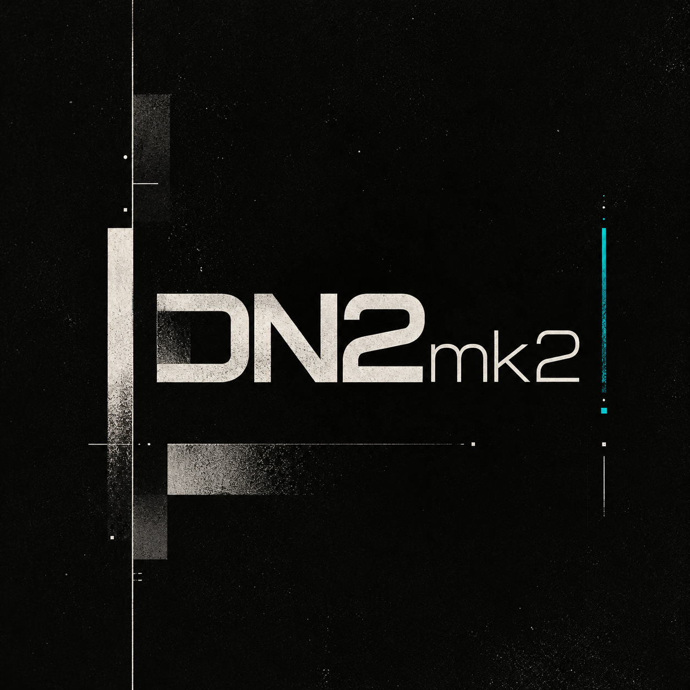
</p>


## What's in it

Every screen below is the firmware itself, captured in the ColdFire emulator by the gate.
Where each feature lives and how to use it is in the
**[manual](https://de-pattern.github.io/dn2mk2/mod-manual.html)**.

### MACHINE SEL

The mod's machines sit in MACHINE SEL ([FUNC] + [SYN]) after the stock ones, each with its
own icon and name in the left pane. A kit that would ask for more DSP time than there is
gets refused with a message, so notes don't drop.

<table><tr><td>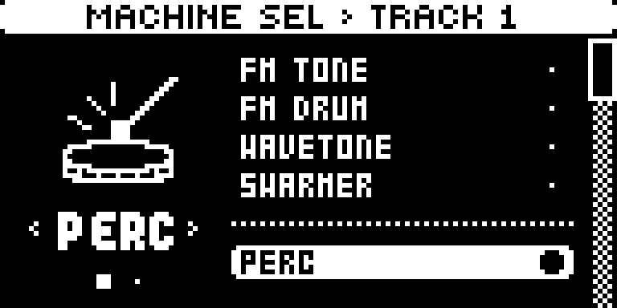</td><td>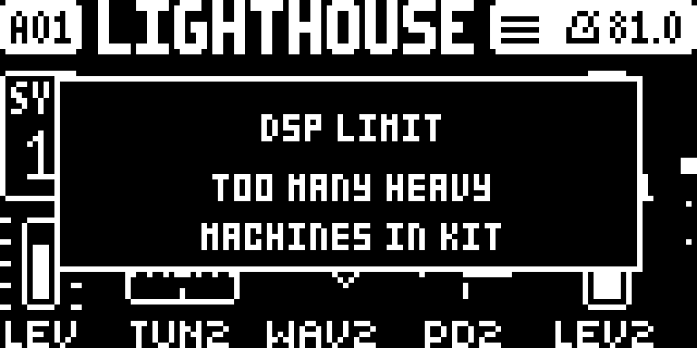</td></tr></table>

### The Digitakt II's sample machines

ONESHOT, WERP, STRETCH, REPITCH, GRID and SLICE, on the DT2's two SRC pages, with the DT2's
own sample engine: its interpolator and decimator, STRETCH's time-stretch, WERP's clock,
and no clicks at starts, ends and retriggers. The waveform shows the playhead.

<table><tr><td>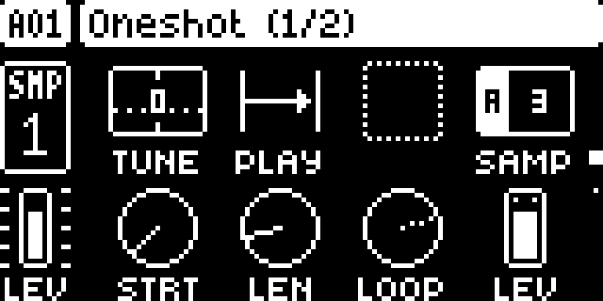</td><td>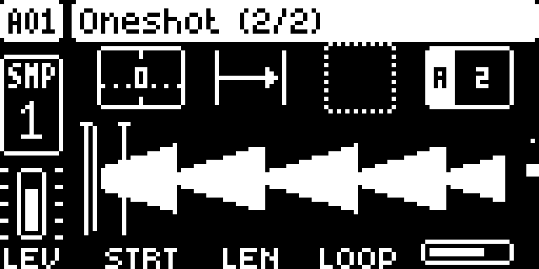</td></tr></table>

- **The sample list and browser**: turn SAMP and the list opens with each slot's long
  name; [FUNC] + [YES] opens the browser, folders and SAMPLE ACTION (load, rename,
  delete, select all). Four PROJECT RAM banks (A..D, 508 slots), and a +Drive library of
  up to 16,384 samples in folders.
- **Your samples** go over USB with the
  [in-browser import tool](https://de-pattern.github.io/dn2mk2/) and stay on the +Drive.
- **Modulation**: an LFO on SAMP or SLCE steps through samples or slices.

<table><tr><td>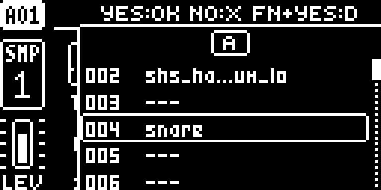</td><td>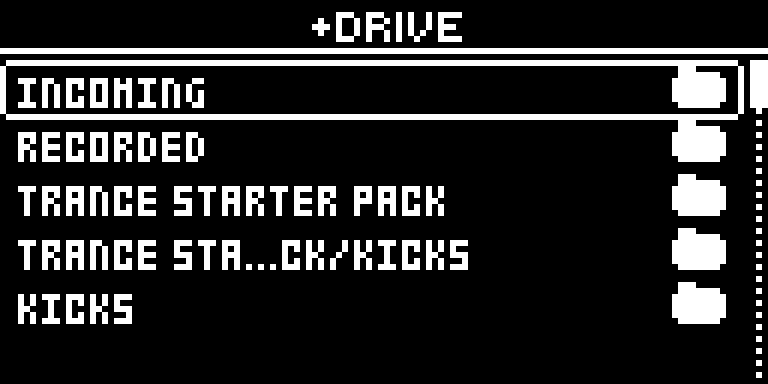</td></tr></table>

**SLICE**: up to 64 slices from your WAV's cue points, a grid, or its hits. Its menu
(**YES** on the page) edits slice points, creates a grid, or locks slices linearly or at
random onto the track's trigs. The slice editor plays edits live, zooms to 128 frames and
snaps to zero crossings. In KEYBOARD the [TRIG] keys play the slices.

<table><tr><td>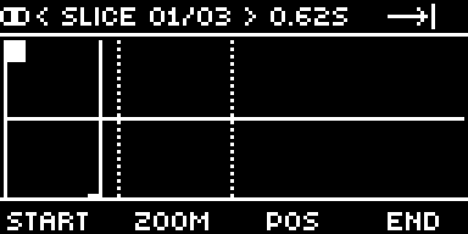</td><td>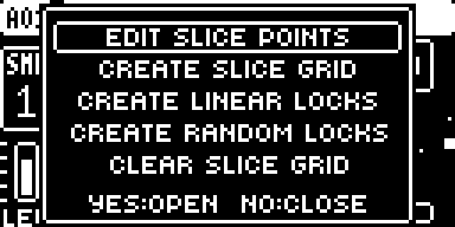</td></tr></table>

**The recorder** ([FUNC] + [VOICE]): record IN, MAIN or any track, with the DT2's TRIM,
NAME and ASSIGN steps and input monitoring. Recordings are kept across power cycles and
copied to the +Drive.

<table><tr><td>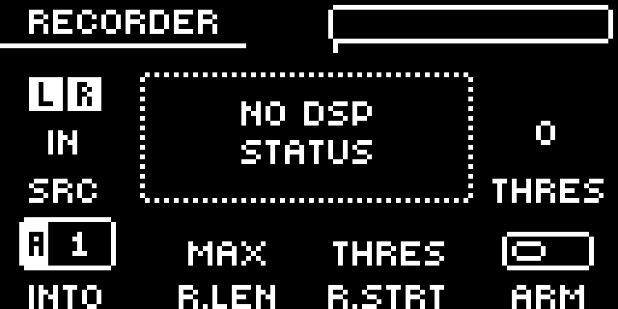</td></tr></table>

### FLEX: the live buffer

FLEX plays one of eight live buffers. Recorder trigs on the sequencer ([TRIG] for one take,
[FUNC] + [TRIG] for every pass) record a track, the input or the main mix into a buffer
while the pattern plays, Octatrack-style; FLEX, and every other sample machine (SAMP past
127), plays it back. REC SETUP has its own gain with a level meter, and can take the
source track out of the mix while it records.

<table><tr><td>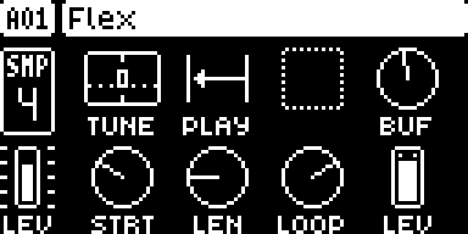</td><td>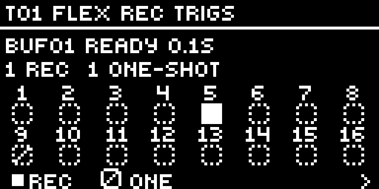</td></tr></table>

### PERC: the Machinedrum

One machine, TYPE choosing among the Machinedrum's TRX, EFM, GND and P-I machines. Each is
a port of the MD's own code from its firmware (you supply the MD's OS file), checked
sample for sample against it. Page 1: the machine's eight parameters, named as on the MD.
Page 2: TYPE and the MD's track effects (AMD, AMF, EQF, EQG, FLTF, FLTW, FLTQ). TYPE is
p-lockable.

<table><tr><td>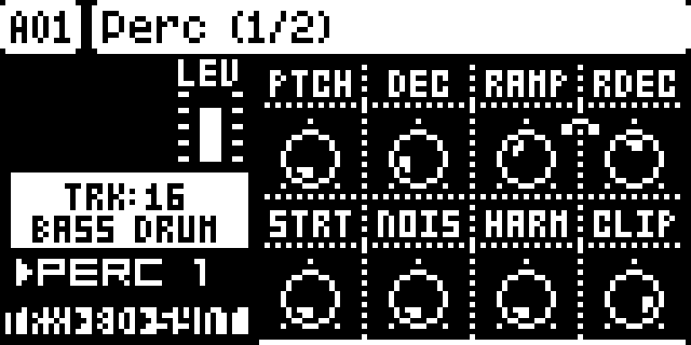</td><td>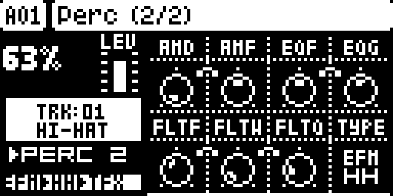</td></tr></table>

### The Monomachine

SID 6581, DPRO WAVE, DPRO DDRW, DPRO DENS, VO-6, and the FM+ machines STAT, PAR and DYN,
each its own machine type, ported from the Monomachine's firmware (you supply its OS
file). Their pages are drawn as the Monomachine's, with its animated controls.

**Polyphonic.** The Monomachine was monophonic: six tracks, one note each. Here a
Monomachine track is a Digitone II track, so each note takes its own voices from the DN2's
16: chords and overlapping notes on every one of them.

<table><tr><td>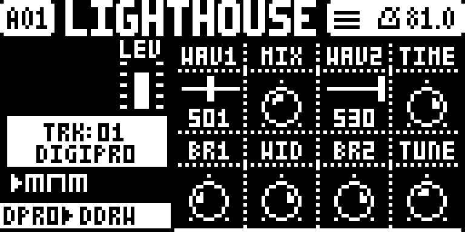</td><td>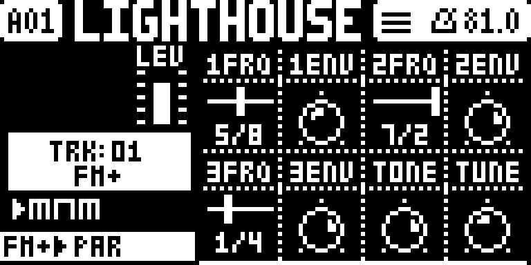</td></tr></table>

### Sequencer and performance

- **PERFORM** ([MOD] + [FX]): eight macros, A..D on the top row and E..H below, after the
  Analog Four MKII's performance mode. Each moves up to five parameters on any tracks,
  each with its own depth, as an offset on top of the sound (its LFOs and p-locks stay).
  BIPOLAR, renaming, PERF MUTE, and saved with the project.
- **Direct Jump** (hold [PTN], [YES] on / [NO] off): a new pattern starts at once, not at
  the end of the current one.
- **Parameter slides** (TRIG page 2: SLD and SLEN): a trig's locks glide in, for a set
  length or all the way to the next trig.
- **Keyboard HOLD** (hold [PTN], press [KEYBOARD]): every track sustains, held notes
  latch, MIDI in and the arp too.
- **Microtuning** (KB SETUP, knob H): a tuning per project, 11 factory tunings and 8 of
  your own, switched per track.
- **The arpeggiator on MIDI tracks**: the ARPEGGIATOR menu on a MIDI track, its notes
  sent out over MIDI.
- **Arp in key** (SETTINGS > PERSONALIZE > ARP OFS IN SCALE): arp offsets count steps of
  the track's scale, not semitones.
- **In-key transpose** ([KEYBOARD] + [FUNC] + [+]/[-]): a track moves by steps of its
  scale.

<table><tr><td>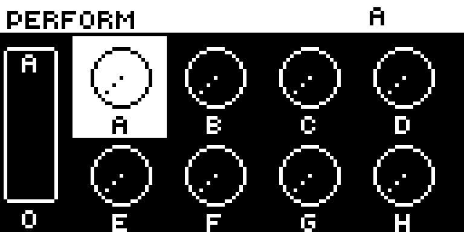</td><td>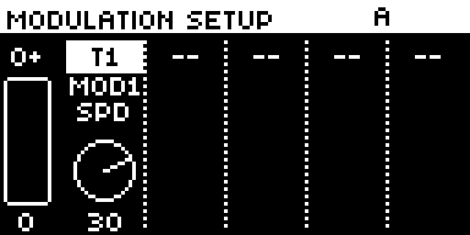</td></tr></table>
<table><tr><td>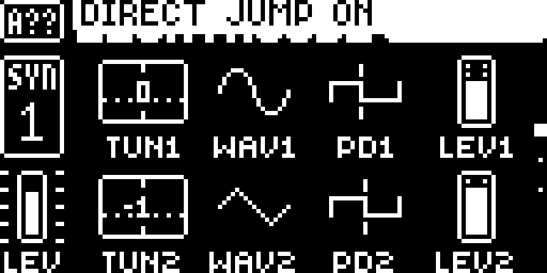</td><td>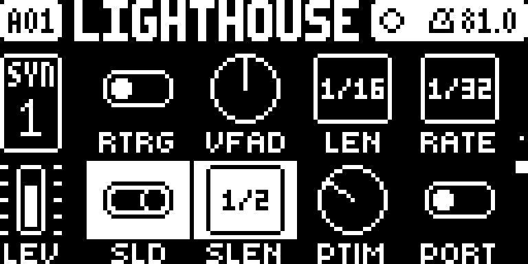</td></tr></table>
<table><tr><td>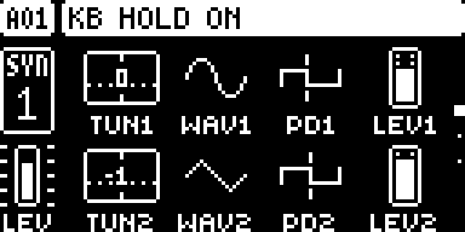</td><td>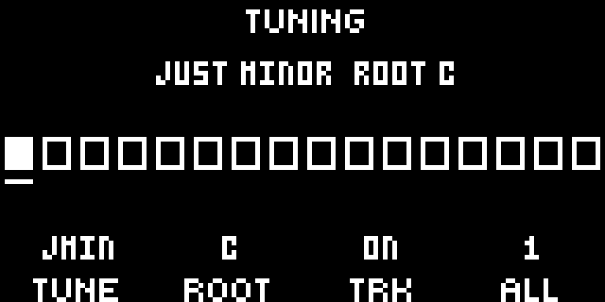</td></tr></table>

### Under the hood

- **A DSP limit and a guard**: MACHINE SEL won't build a kit past what the DSP can run,
  and if the DSP still runs short of time, our voices are left out for a block instead of
  the audio stopping (**CPU** shows while it happens). [FUNC] on a PERC or Monomachine page
  shows the load.
- **Stock questions stay stock's**: the OS update and save questions take their keys on
  every page.
- **ERASE MOD DATA** (top of the sample browser) clears everything the mod keeps on the
  +Drive, before going back to stock for good.

---

## Install

You need a Digitone II on **OS 1.11**, Chrome or Edge, a USB cable, Elektron Transfer,
and your own copies of these Elektron OS files (the patcher asks for them; nothing of
Elektron's is published here):

- Digitone II OS 1.11 (the one it patches)
- Digitakt II OS 1.17 (the sample engine's tables)
- Machinedrum UW OS 1.63 (PERC's machines)
- Monomachine SFX-6/60 OS 1.32B, Elektron's `Elektron_SFX6-60_OS1.32B.syx` (the Monomachine machines)

Then:

1. **Back up** your projects, presets and samples with Transfer.
2. **Prove recovery once** with stock 1.11 over a DIN MIDI cable
   ([Going back, and recovery](#going-back-and-recovery)). Until this has worked once,
   flash nothing modified.
3. Open the **[DN2 Mod Patcher](https://de-pattern.github.io/dn2mk2/patcher.html)**, pick a
   version, give it your OS files. It builds the firmware in your browser (a few minutes)
   and lets you save it **only if it is byte for byte the version that passed the gate**.
4. Send the saved `.syx` to the Digitone with Transfer, at low volume, as any OS update.
5. Run the **regression check** (`docs/SAFETY.md`, about 10 minutes): the stock machines,
   effects, a pattern, a p-lock, save and reload. Then the version's own tests in
   [`FIRMWARE.md`](FIRMWARE.md).

To send samples: the [import tool](https://de-pattern.github.io/dn2mk2/) (Chrome or Edge,
USB CONFIG set to USB MIDI or Overbridge, Transfer closed).

---

## Going back, and recovery

- **Back to stock**: send Elektron's own `Digitone_II_OS1.11.syx` with Transfer, as any
  update.
- **If it will not boot**: hold [FUNC] while powering on, press [TRIG 4], and send stock
  1.11 with Transfer's *Legacy OS upgrade mode* over a **5-pin DIN MIDI cable** to the
  Digitone's MIDI IN (USB does not work in this mode). It takes about 12 minutes; do not
  interrupt it. The mod never touches the bootstrap that runs this, and the build tool
  refuses any file that would.

`docs/SAFETY.md` lists every way a flash could harm a Digitone II and what stops each one.

---

## Compatibility

- **Digitone II OS 1.11 only.** Every address is measured on 1.11; the tools refuse any
  other file. A unit on 1.10 updates to stock 1.11 first; one on 1.12 goes back to 1.11
  (`docs/SAFETY.md`).
- Projects, presets and kits are stock's formats. Projects that use the mod's machines need
  the mod to play those tracks; back them up before going back to stock.
- Your samples live in a region of the +Drive stock never uses; stock firmware ignores it.

## Known limitations

- **DSP time.** The Machinedrum and Monomachine machines cost far more DSP than the stock
  ones. MACHINE SEL refuses a kit past the DSP limit; within it, many voices sounding at
  once with heavy p-locks can still leave voices out for a moment (CPU shows).
- **Power-on load time** grows with the samples you keep (about 30 s for 20 MB).
- The open reports, and what each version fixes, are in [`FIRMWARE.md`](FIRMWARE.md) and
  `docs/user-reports.md`.

---

## How it's made and tested

The mod is built by a Python tool from Elektron's files, as patches to the ColdFire's code
and the DSP's image. **No build is published until `scripts/ship_gate.py` prints
`CLEARED TO FLASH` on that exact file**:

- **Preflight**: the bootstrap, updater, metadata and Outbox are byte-identical to
  stock; signature and sizes checked.
- **DSP**: the stock machines are bit-identical to stock in a SHARC simulator, and every
  new voice is bit-exact to its reference model, block by block.
- **ColdFire**: the build boots from reset in an emulator, its engine, save and load run,
  and every new screen and key is driven and checked.
- **Unit tests.**

The patcher only saves a file whose sha256 is the cleared build's. What remains unchecked
until it is on hardware is said in each version's notes.

Building it yourself: Python 3.11+, `pip install -e .`, then
`dnfw mods apply Digitone_II_OS1.11.syx --mod waverider -o build.syx` (the other OS files in
`00_Resources/`). The gates need [digikit](https://github.com/m-dwyer/digikit) and
[selache](https://github.com/js216/selache) (`docs/SAFETY.md`, `docs/emulator.md`).

## Versions

Every version, newest first, with its sha256, what it adds and what to test:
[`FIRMWARE.md`](FIRMWARE.md). The files themselves are on the `builds` branch, and the
patcher builds any of them from your OS files.

## Credits

- **[dn2_firmware_explore](https://github.com/xrcstrecords/dn2_firmware_explore)** by
  Ángel Linares: the firmware map, the tooling and the first new machine. This project
  started as its fork; what changed is in
  [`docs/CHANGES-FROM-UPSTREAM.md`](docs/CHANGES-FROM-UPSTREAM.md), and its README is kept
  at [`docs/UPSTREAM-README.md`](docs/UPSTREAM-README.md).
- **[w-winter](https://github.com/w-winter)**: arp offsets in key and in-key transpose
  (his upstream mods, applied as they are), and **Ángel Linares** for the MIDI arp.
- **[digikit](https://github.com/m-dwyer/digikit)**: the ColdFire and SHARC emulators
  (GPL-2.0-or-later), used as external tools.
- **[selache](https://github.com/js216/selache)**: the SHARC+ assembler (GPL-3.0), used as
  an external tool.
- **[elektron-firmware-tool](https://github.com/mischa85/elektron-firmware-tool)** and the
  others in [`THIRD-PARTY.md`](THIRD-PARTY.md).

Not affiliated with Elektron. *Digitone*, *Digitakt*, *Machinedrum* and *Monomachine* are
Elektron's; names are used only to say what a machine is modelled on.

## Licence

[GNU AGPL-3.0-or-later](LICENSE), as upstream. Use it, fork it, change it; keep the
notices and pass on the same freedoms.
